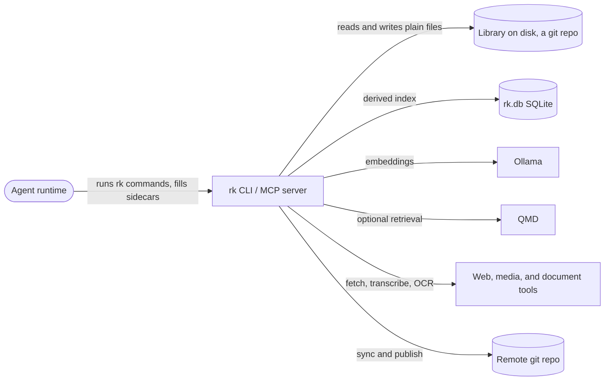

# Architecture

Technical architecture hub: how research-keeper (`rk`) is built and deployed. For what the system means in its domain, see [`DOMAIN-MODEL-L1.md`](DOMAIN-MODEL-L1.md). Detail lives in [`technical-architecture/`](technical-architecture/README.md).

## Shape

rk is a Python command-line tool with an optional MCP server. It never calls an LLM. When it needs intelligence (tagging, synthesis, query answers), it writes a Jinja2 sidecar file describing the request, and the user's agent fills a matching output file. A later `rk resolve` reads that output and advances the pipeline. All durable state is plain files in a library directory that the user keeps in git. A SQLite database (`rk.db`) holds a search index and embeddings; it is derived and can be rebuilt from the files.

The code follows a ports-and-adapters layout: `src/research_keeper/ports/` defines protocols (`SourceStore`, `TagStore`, `QueryStore`, `InvestigationStore`, `Index`, `Embedder`, `Retriever`, `Normalizer`, `Transport`), and `src/research_keeper/adapters/` implements them.

## Spokes

| Spoke | Covers |
|---|---|
| [`technical-architecture/c4/context.md`](technical-architecture/c4/context.md) | Actors and external systems |
| [`technical-architecture/c4/container.md`](technical-architecture/c4/container.md) | Runtime processes and data stores |
| [`technical-architecture/c4/component.md`](technical-architecture/c4/component.md) | Components inside the rk process |
| [`technical-architecture/c4/deployment.md`](technical-architecture/c4/deployment.md) | Install paths and where things run |
| [`technical-architecture/tech-stack.md`](technical-architecture/tech-stack.md) | Languages, libraries, and infrastructure choices |

## Decisions that shape the architecture

Implemented:

- [ADR-001](adr/Active/%28ADR-001%29-Sidecars-As-Completion-Contract.md): sidecars are the contract between rk and the agent
- [ADR-002](adr/Active/%28ADR-002%29-Jinja2-Template-Sidecars.md): Jinja2 templates are the sidecar format

Proposed, and not implemented in the code (the memory-lifecycle design, ADR-010 through ADR-019; the lock in `rk resolve` is a small subset of ADR-016):

- [ADR-013](adr/Proposed/%28ADR-013%29-Disk-State-As-Deterministic-Projection/%28ADR-013%29-Disk-State-As-Deterministic-Projection.md): disk state is a deterministic projection of its inputs
- [ADR-016](adr/Proposed/%28ADR-016%29-Advisory-File-Lock-For-Concurrency/%28ADR-016%29-Advisory-File-Lock-For-Concurrency.md): an advisory file lock guards state-changing commands (today the lock covers `rk resolve`)
- [ADR-017](adr/Proposed/%28ADR-017%29-Sidecar-Output-As-Untrusted-Input/%28ADR-017%29-Sidecar-Output-As-Untrusted-Input.md): sidecar output is untrusted input and is validated before it is written

The C4 pages describe what the code does today.
