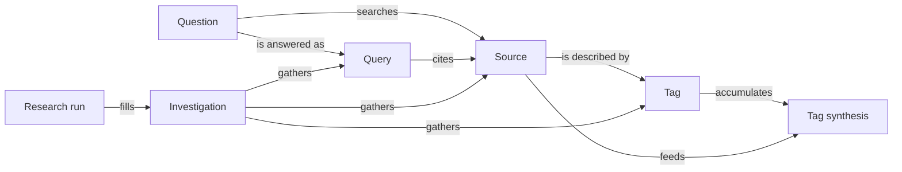

# Domain model, L1: ubiquitous language

Plain-language glossary for research-keeper (`rk`). Developers and agents who need attributes, cardinality, and invariants should read [`domain-architecture/DOMAIN-MODEL-L2.md`](domain-architecture/DOMAIN-MODEL-L2.md). Context boundaries are in [`domain-architecture/CONTEXT-MAP.md`](domain-architecture/CONTEXT-MAP.md).

The domain in one sentence: a person saves things worth knowing, and the library keeps their understanding of each topic current as new material arrives.

## Terms by context

### Library

- **Library**: the user's whole collection, a directory of plain files kept in git. Everything the user cares about is readable without rk.
- **Source**: one saved item (an article, paper, video, note, or document), stored as markdown. A source records where it came from, when it was saved, and when it was published.
- **Origin**: where a source came from, such as a URL, a file path, or a note. It travels with the source.
- **Freshness**: how current a source is, from its publish date, its save date, and a time-to-live (default 30 days). Fresher sources count for more in search.
- **Prune**: remove a source from the library by moving it aside, not erasing it. A pruned source stops appearing in search and syntheses.
- **Normalize**: convert whatever was saved (web page, PDF, video) into markdown. Video becomes a transcript; a video with no subtitles gets its burned-in text read by OCR.

### Synthesis

- **Tag**: a short lowercase name for a theme. Sources get three to seven tags when they are added. Tags can optionally relate to each other as broader, narrower, or related.
- **Tag synthesis**: a written summary of everything the library knows about a tag, organized by theme and citing its sources. It is rewritten when a source joins the tag.

### Retrieval

- **Search**: ask a question in words and get an answer that cites specific sources, weighted toward fresh ones. Search matches by meaning, not only by keyword.
- **Keyword search**: exact-word lookup across all sources, with no agent involved.
- **Query**: a saved question with its answer and the sources it cited.

### Investigation

- **Investigation**: an ongoing line of inquiry with a topic and a brief. It collects sources, queries, and tags over time and keeps a rolling summary. It is open, paused, or closed.
- **Research run**: a bounded, automatic exploration that starts from seed sources and expands outward until a budget (sources, effort, or time) runs out.
- **Branch**: one direction a research run explores. It is active, exhausted, or failed.

### Sidecar exchange

- **Sidecar**: a file rk writes to ask the user's agent for thinking, such as tags for a new source. The agent writes an answer file next to it. rk never calls a language model itself.
- **Resolve**: the step where rk reads the agent's answers and moves the library forward. The agent runs it repeatedly until rk reports Done.

### Library sharing

- **Sync and publish**: pull a shared library from a git remote, or push changes back to it.
- **Export**: package a slice of the library (a tag, a source, an investigation, or a query) as a zip with every link turned into a real file.
- **Import**: bring sources, queries, tags, and investigations in from another rk library or from a trove.

## Business rules

- Saving a source never waits on thinking. If tagging is unavailable, the source is still filed.
- A duplicate source (same content) is not added twice.
- Adding a source updates the synthesis of every tag it joins.
- The database is a convenience. Deleting it loses nothing; `rk rebuild` recreates it from the files.

## Avoid

| Say | Not | Why |
|---|---|---|
| Source | Document, reference, note | "Document" is one kind of source; "reference" is a term from the unimplemented memory-lifecycle design |
| Tag synthesis | Summary | A summary condenses one source; a synthesis combines many |
| Investigation | Research | Investigations are manual and open-ended; research runs are bounded and automatic |
| Prune | Delete | Pruned sources are kept aside and can be restored |
| Sidecar | Prompt | A sidecar is a file on disk that survives interruption, not a one-shot message |
