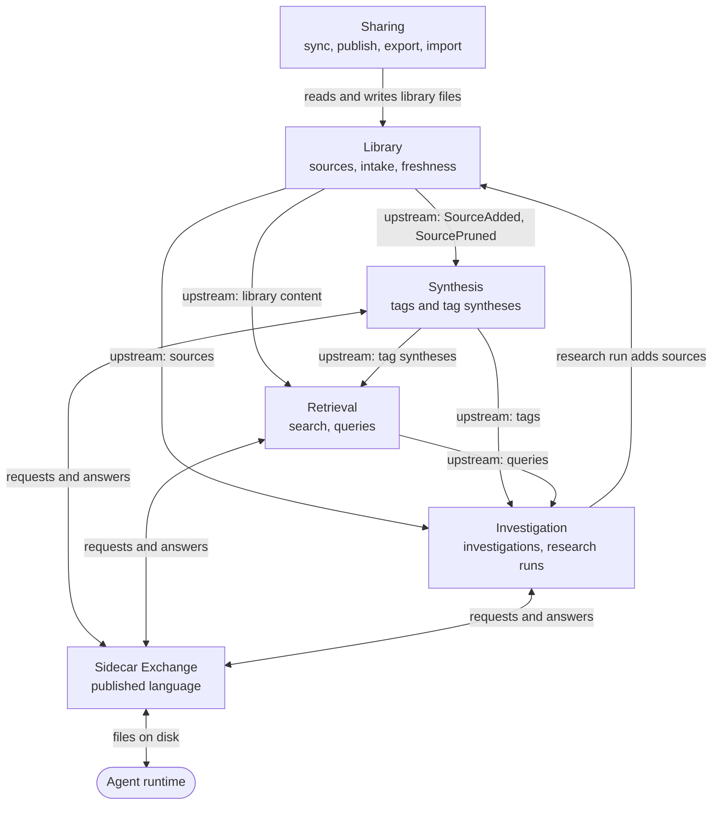

# Context map

research-keeper has six bounded contexts. They share one codebase and one library directory, so most integration happens through files on disk and through `rk resolve`.

## Contexts

| Context | Owns | Main code |
|---|---|---|
| Library | Sources, normalization, dedup, freshness, prune | `pipeline.py`, `adapters/normalizers/`, `adapters/filesystem/source_store.py` |
| Synthesis | Tags, tag synthesis | `adapters/filesystem/tag_store.py`, tag handling in `resolve.py` |
| Retrieval | Search, keyword search, queries | `query_pipeline.py`, `retrieval.py`, `adapters/retriever/`, `adapters/sqlite/index.py` |
| Investigation | Investigations, research runs | `investigation_pipeline.py`, `research_pipeline.py`, `research_expansion.py` |
| Sidecar Exchange | The request and answer files, and `rk resolve` | `sidecar.py`, `resolve.py`, `templates/` |
| Sharing | Remote sync and publish, export, import, transports | `remote.py`, `export.py`, `import_rk.py`, `adapters/transports/` |

## Relationships

| Upstream | Downstream | Pattern | Notes |
|---|---|---|---|
| Library | Synthesis | Upstream/downstream | Synthesis reacts to new and pruned sources; it never changes them |
| Library | Retrieval | Upstream/downstream | Retrieval reads sources through the index and the files |
| Synthesis | Retrieval | Upstream/downstream | Search results can cite tags |
| Library, Synthesis, Retrieval | Investigation | Conformist | An investigation links to nodes by slug and takes them as they are |
| Investigation | Library | Upstream/downstream | A research run adds sources through the normal intake path |
| Sidecar Exchange | Agent runtime (external) | Open host service, published language | The `.j2` sidecar and its output file formats are the public contract; see ADR-001 |
| Sidecar Exchange | Library, Synthesis, Retrieval, Investigation | None today | Agent output is read as written. ADR-017 specifies an anticorruption layer that validates it; the code does not implement that yet |
| Sharing | Library | Partnership | Sharing moves whole library files and does not interpret them |
