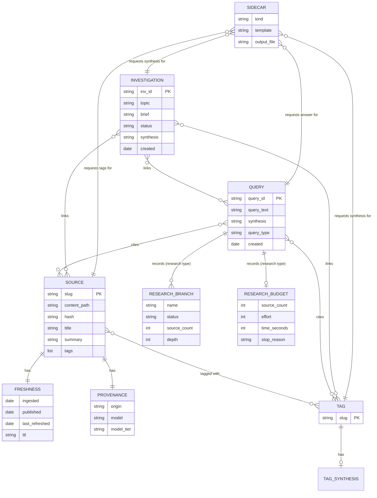

# Domain model, L2: ubiquitous language for developers and agents

Technical semantics for research-keeper. The plain-language version is [`../DOMAIN-MODEL-L1.md`](../DOMAIN-MODEL-L1.md). This page describes what the code implements today (`src/research_keeper/models.py` and the filesystem adapters). ADR-010 through ADR-019 are Proposed: they describe a larger memory-lifecycle model (tiers, claims, decay) that is not in the code, and they are out of scope here.

## ERD

## Building blocks

| Concept | Kind | Definition |
|---|---|---|
| `Source` | Entity, aggregate root | Identified by slug. Immutable dataclass holding normalized content, `Freshness`, `Provenance`, tags, and a content hash |
| `Freshness` | Value object | `ingested`, optional `published` and `last_refreshed` dates, and a `ttl` string (default `30d`) |
| `Provenance` | Value object | `origin`, and optionally the `model` and `model_tier` (`frontier` or `standard`) that produced the content |
| Tag | Entity, aggregate root | A directory `tags/<slug>/` with `meta.yaml`, `synthesis.md`, and a `sources/` directory of symlinks to member sources. Tag edges (`broader`, `narrower`, `related`) are specified by ADR-019 |
| `QueryNode` | Entity, aggregate root | A saved question: text, synthesis, cited sources and tags, `query_type` (`search` or `research`), and for research runs the branches, budgets, and branch outcomes |
| `Investigation` | Entity, aggregate root | `inv_id`, `topic`, `brief`, `status` (`open`, `paused`, `closed`), rolling `synthesis`, and linked sources, queries, and tags |
| `ResearchBranch` | Value object | A named exploration direction with `status` (`active`, `exhausted`, `failed`), `source_count`, and `depth` |
| `ResearchBudget` | Value object | Stop conditions: `source_count` (default 50), optional `effort` (API calls) and `time_seconds`, and the `stop_reason` when one fires |
| `ScoredNode` | Value object | A retrieval hit: `slug`, `content`, `score`, `similarity`, `freshness_weight`, optional chunk index and heading |
| Sidecar | Entity (file) | A `.j2` request in a `.pending/` directory plus the agent's output file. Kinds: `tag.j2` to `tag.yaml`, `synthesize.j2` to `synthesize.md`, `query.j2` to `query.md` |

## Repositories (ports)

| Port | Aggregate | Filesystem adapter |
|---|---|---|
| `SourceStore` | Source | `library/sources/<slug>/` with `manifest.yaml` and `<slug>.md` |
| `TagStore` | Tag | `tags/<slug>/` |
| `QueryStore` | QueryNode | `queries/<id>/` with `meta.yaml` and `synthesis.md` |
| `InvestigationStore` | Investigation | `investigations/<id>/` with `meta.yaml` and `synthesis.md` |
| `Index` | (read model) | SQLite `rk.db`: `nodes`, `edges`, `embeddings`, FTS5 `node_search` |

## Domain services

| Service | Role |
|---|---|
| IntakePipeline | identify, normalize, dedup, file, embed, index, queue a tag sidecar |
| `run_resolve` | Apply completed sidecars and advance the pipeline, in a fixed stage order |
| QueryPipeline | Retrieve and queue a query sidecar |
| ResearchPipeline | Expand from seeds within a `ResearchBudget` |
| Retrievers | Semantic (embeddings weighted by freshness), QMD, and HYDE query expansion for full-text search |

## Invariants

1. A source slug is unique in the library, and a source with the same content hash is not added twice when `intake.dedup` is on.
2. A `Source` is a frozen dataclass; changing content means re-normalizing from the preserved original, not editing in place.
3. Every state-changing `rk resolve` holds `.rk-resolve.lock`; a lock whose owning process is dead is overridden.
4. `rk.db` is derived: removing it and running `rk rebuild` yields an equivalent index.
5. A `.j2` sidecar is never moved, renamed, or deleted by the agent; `rk resolve` removes the `.pending/` directory after it consumes the answer.
6. Pruning moves a source to `library/.deleted/` rather than erasing it, and removes it from the index.
7. An investigation's `status` is one of `open`, `paused`, or `closed`; closing records a final synthesis.
8. A research run stops when any budget is exhausted and records the `stop_reason`.

## Domain events

Events that stay inside one context (a branch becoming `exhausted`, an investigation closing) are internal. Cross-context events are in [`DOMAIN-EVENTS.md`](DOMAIN-EVENTS.md).
