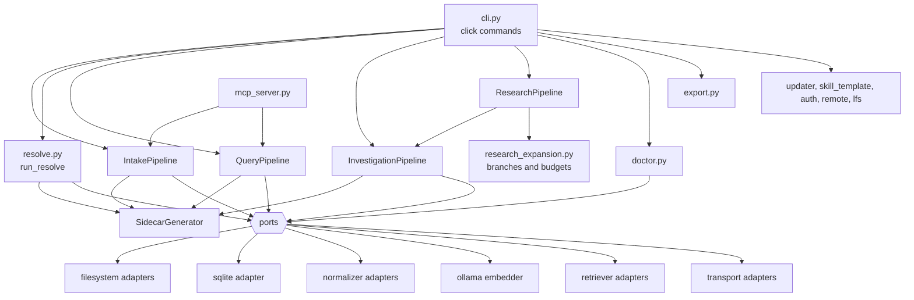

# C4 level 3: components in the rk process

The rk process follows ports and adapters. Pipelines depend on protocols in `ports/`; `adapters/` supplies the implementations.

## Ports and adapters

| Port (`ports/`) | Adapters (`adapters/`) |
|---|---|
| `SourceStore`, `TagStore`, `QueryStore`, `InvestigationStore` | `filesystem/source_store.py`, `tag_store.py`, `query_store.py`, `investigation_store.py` |
| `Index` | `sqlite/index.py` |
| `Embedder` | `embedder/ollama.py` |
| `Retriever` | `retriever/semantic.py`, `retriever/qmd.py`, plus the `hyde.py` query expander |
| `Normalizer` | `normalizers/web.py`, `documents.py`, `media.py`, `notes.py`, `x_thread.py`, with `identifier.py` choosing by input type |
| `Transport` | `transports/transports.py` (`file:`, URL, text, `wormhole:` inputs) and `resolver.py` |

## Pipelines

| Component | Role |
|---|---|
| IntakePipeline (`pipeline.py`) | Normalize input, dedup by hash, store the source, chunk and embed it, and queue a tag sidecar |
| `run_resolve` (`resolve.py`) | Read completed sidecars, apply tags, queue and apply syntheses, apply query and investigation output, reconcile the index with the files |
| QueryPipeline (`query_pipeline.py`) | Retrieve sources for a question and queue a query sidecar |
| InvestigationPipeline (`investigation_pipeline.py`) | Create investigations, link nodes, and queue rolling syntheses |
| ResearchPipeline (`research_pipeline.py`) | Seeded exploration with source, effort, and time budgets, using branch planning from `research_expansion.py` |
| SidecarGenerator (`sidecar.py`) | Render Jinja2 sidecar templates into `.pending/` directories |
| `doctor.py` | Health checks: duplicate hashes, orphaned symlinks, missing embeddings, stale sidecars, orphaned locks, index drift |
