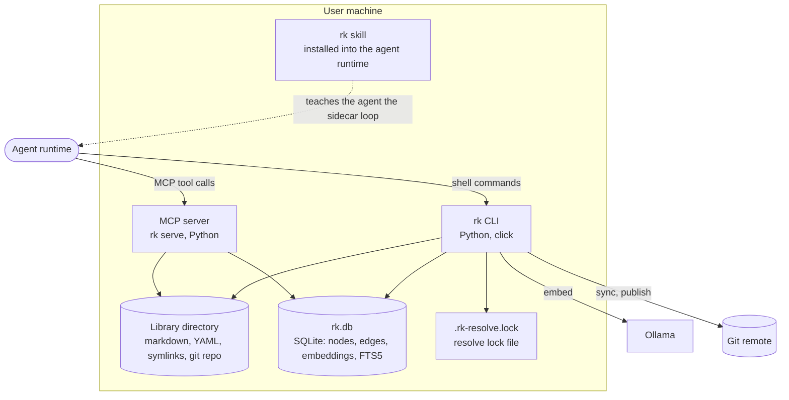
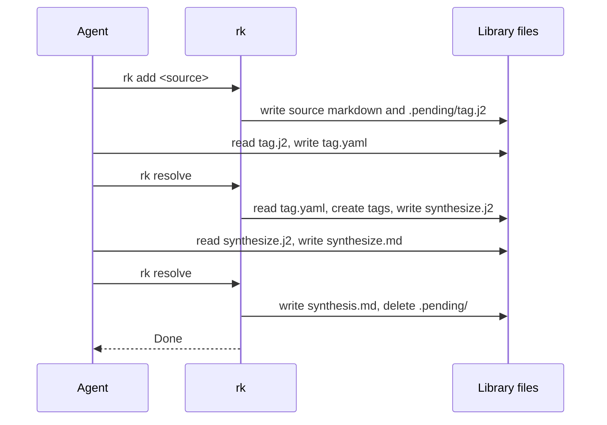

# C4 level 2: containers

rk runs as short-lived processes over a directory of files. There is no daemon unless the MCP server is started.

## Containers

| Container | Technology | Responsibility |
|---|---|---|
| rk CLI | Python 3.11+, click | Every command: add, resolve, search, investigate, research, tags, doctor, export, prune, sync, publish, update, skill, auth |
| MCP server | Python, `mcp` | Exposes add, search, keyword-search, tags, investigate, rebuild, and status tools over MCP; started by `rk serve` |
| Library directory | Files, git, Git LFS | Source of truth: `library/sources/`, `tags/`, `queries/`, `investigations/`, `rk.yaml` |
| rk.db | SQLite with FTS5 | Derived search index and embeddings; `rk rebuild` regenerates it |
| Resolve lock | `.rk-resolve.lock` file holding the owner's pid | Keeps two `rk resolve` runs from interleaving; a lock whose process is dead is overridden |
| rk skill | Markdown template (`src/research_keeper/templates/skill.md`) | Instructions installed by `rk skill install` so an agent knows the sidecar loop |

## Key flows

