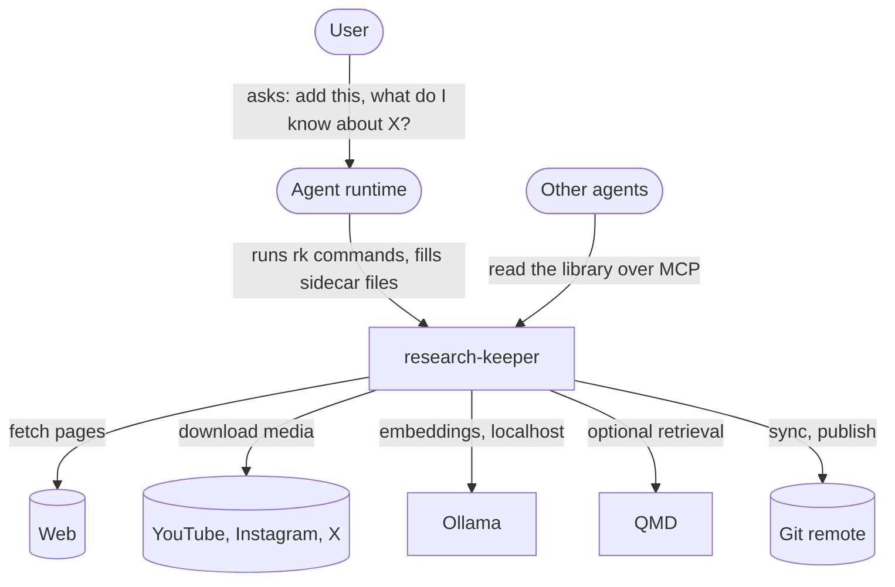

# C4 level 1: system context

research-keeper (`rk`) is a personal research library driven by an AI agent. The user talks to their agent; the agent runs `rk` and does the thinking that `rk` asks for.

## Actors

| Actor | Role |
|---|---|
| User | Owns the library and asks questions in natural language |
| Agent runtime | OpenCode, Claude Code, Codex, Gemini, or similar. Runs `rk` and supplies all LLM output through sidecar files |
| Other agents | Read a library through `rk serve` (MCP) |

## External systems

| System | Interaction |
|---|---|
| Web pages | Fetched and converted to markdown |
| Media sites | Video and audio downloaded with yt-dlp, then transcribed or OCR'd |
| Ollama | Local embedding service |
| QMD | Optional retriever subprocess |
| Git remote | Holds a shared library for `rk sync` and `rk publish` |
