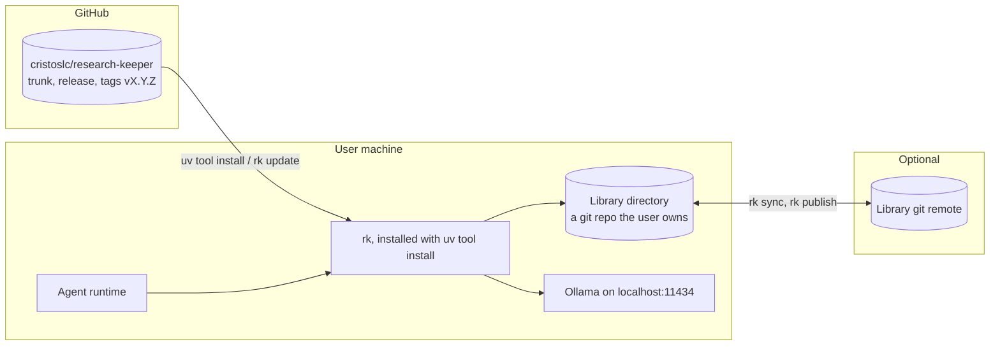

# Deployment

rk is a local tool. There is no hosted service. Every user runs rk on their own machine against their own library.

## Environments

| Environment | What it is |
|---|---|
| Production | A user's installed `rk` (from the git repo), working on their library |
| Development | A clone of the repo with `uv sync --all-extras`; `uv run rk` uses the working tree |
| Staging | A throwaway install of a branch in a temporary directory, built by `scripts/staging/deploy.sh` |

## Install paths

- End users: `uv tool install "research-keeper[all] @ git+https://github.com/cristoslc/research-keeper.git"`, then `rk skill install` inside the project that will hold the library.
- Developers: `git clone`, then `uv sync --all-extras`.
- `rk update` detects which of the two applies and runs the matching update.

## Release channel

Release commits and `vX.Y.Z` tags land on `trunk`; the `release` branch follows by merge. See [`../../agents-detail/release.md`](../../agents-detail/release.md).
